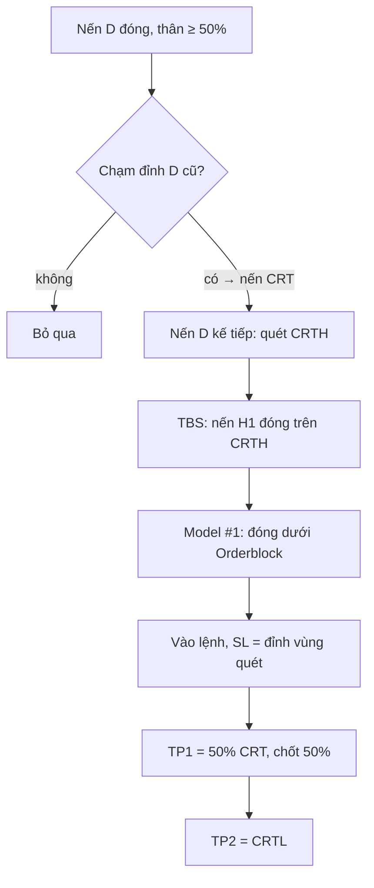

# CRT + TBS Trading System

Hệ thống giao dịch tự động theo phương pháp **CRT (Candle Range Theory) + TBS (Turtle Body Soup)** cho
MetaTrader 5, gồm bộ backtest mô phỏng trên nến M1 và bot live báo tín hiệu qua Telegram.


> [!WARNING]
> **Chiến lược chưa chứng minh được lợi thế.** Backtest D → H1 không đạt bộ tiêu chí đã ghi trước khi chạy
> (E[R] +0,064R mỗi lệnh, khoảng tin cậy 95% chứa 0, âm khi chi phí ×2), và cả 3 lần kiểm tra trên khung / thị
> trường khác đều thua. Chỉ chạy bot trên **tài khoản Demo**. Xem [Kết quả backtest](#kết-quả-backtest).

## Mục lục

- [Tổng quan](#tổng-quan)
- [Chiến lược](#chiến-lược)
- [Kết quả backtest](#kết-quả-backtest)
- [Cài đặt](#cài-đặt)
- [Cấu hình](#cấu-hình)
- [Sử dụng](#sử-dụng)
- [Kiểm thử](#kiểm-thử)
- [Cấu trúc dự án](#cấu-trúc-dự-án)
- [Phương pháp đánh giá](#phương-pháp-đánh-giá)
- [Giới hạn đã biết](#giới-hạn-đã-biết)
- [Miễn trừ trách nhiệm](#miễn-trừ-trách-nhiệm)

## Tổng quan

| Thành phần | Mô tả |
|---|---|
| **Chiến lược** (`crt_tbs.py`) | Một module thuần (không phụ thuộc MT5) dùng chung cho backtest và bot — cùng một quy tắc, không lệch logic |
| **Backtest** (`backtest.py`) | Mô phỏng từng lệnh trên nến M1, tính chi phí spread + trượt giá, bootstrap CI95, bảng balance theo năm / tháng |
| **Bot live** (`bot.py`) | Một tiến trình cho mọi mã; mặc định chỉ báo tín hiệu, tùy chọn tự vào 2 lệnh 50/50 và dời hoà vốn |
| **Ảnh setup** (`plot_setup.py`) | Vẽ setup vào lệnh (khung D + H1, các mốc quét / TBS / Orderblock / Model #1, Entry / SL / TP, lý do) — bot gửi kèm mỗi tín hiệu Telegram; xuất ảnh các lệnh backtest ra PDF / PNG |
| **Xuất dữ liệu** (`export_data.py`) | Lấy nến H1 + M1 từ MT5 (chỉ đọc), lưu kèm sha256 và kiểm M1 gộp khớp H1 |
| **An toàn** | Dữ liệu backtest phải khớp sha256; bot chặn tự đặt lệnh trên tài khoản thật, sai tên mã, sai múi giờ sàn |

Mã mặc định: **XAUUSD, EURUSD, GBPUSD, AUDUSD** (trên sàn BCR-MT5: `XAUUSD.s`, `EURUSD.s`, …).

## Chiến lược

Khung **D → H1**: chọn nến CRT trên D, vào lệnh trên H1. Mô tả chiều BÁN; chiều MUA đối xứng.
Quy tắc đầy đủ kèm tên hàm thực hiện: [RULES.md mục 2](RULES.md#2-quy-tắc-chiều-bán-mua-đối-xứng).



- **Nến CRT:** nến D đã đóng (17:00 New York), thân ≥ 50% biên độ, high chạm một đỉnh D cũ **chưa bị lấy**.
- **TBS:** nến H1 đầu tiên trong nến D kế tiếp **đóng cửa** trên CRTH; chỉ râu vượt (TWS) không tính.
- **Model #1:** nến H1 đóng dưới giá mở của nến tăng gần nhất tính từ TBS (Orderblock) → vào lệnh thị trường.
- **Quản lý:** TP1 = 50% nến CRT, chốt 50% khối lượng và dời SL phần còn lại về giá vào; TP2 = CRTL.
- Hết nến D kế tiếp mà chưa có xác nhận → huỷ setup.
- Bỏ lệnh nếu giá vào không nằm giữa TP1 và SL, hoặc khoảng SL ≤ chi phí (spread + 5 point).
- Mỗi nến CRT tối đa một lệnh; **mỗi mã tối đa một lệnh mở**.

Nguồn: bộ tài liệu CRT + TBS của AR. Những điểm tài liệu không định nghĩa (Model #1, vị trí SL, key level, cặp
khung) do người dùng chốt trước khi backtest — xem [RULES.md mục 1](RULES.md#1-nguồn-quy-tắc).

## Kết quả backtest

Mô phỏng trên nến M1, giá Bid, chi phí = spread thực của nến + 5 point. Đơn vị **R** = số tiền rủi ro mỗi lệnh
(khoảng cách giá vào → SL).

| Cấu hình | Lệnh | Win | E[R] | CI95 | E[R] chi phí ×2 | Kết luận |
|---|---:|---:|---:|---|---:|---|
| **Lần 1** — D → H1, 5 mã (ghi trước) | 311 | 35,7% | +0,064 | −0,146 … +0,289 | −0,050 | ❌ Không đạt |
| D → H1, 4 mã, bỏ NZD *(trong mẫu)* | 279 | 36,6% | +0,092 | −0,128 … +0,321 | −0,012 | — |
| Lần 2 — H4 → M5, 5 mã *(trong mẫu)* | 1 674 | 25,5% | −0,261 | −0,37 … −0,15 | −0,325 | ❌ Không đạt |
| Lần 3 — D → H1, US30 / US100 / US500 *(ngoài mẫu)* | 236 | 25,8% | −0,246 | −0,48 … +0,02 | −0,348 | ❌ Không đạt |
| Lần 4 — D → H1, BTC / ETH *(ngoài mẫu)* | 171 | 28,1% | −0,306 | −0,55 … −0,05 | −0,412 | ❌ Không đạt |

<details>
<summary><b>Chi tiết cấu hình hiện tại (4 mã, D → H1)</b></summary>

| Mã | Dữ liệu | Lệnh | Win | E[R] | E[R] ×2 |
|---|---|---:|---:|---:|---:|
| XAUUSD | 2021-08 → 2026-10 | 94 | 35,1% | +0,043 | +0,018 |
| EURUSD | 2019-10 → 2026-10 | 109 | 36,7% | +0,036 | −0,146 |
| GBPUSD | 2019-10 → 2021-12 | 35 | 31,4% | +0,126 | −0,027 |
| AUDUSD | 2019-10 → 2021-12 | 41 | 43,9% | +0,327 | +0,261 |

Vốn 10 000 USD, rủi ro 1% / lệnh (không tái đầu tư): **10 000 → 12 570 USD (+25,7%)**, max drawdown balance 16,6%.
Bảng theo năm / tháng: [`reports/thong_ke_D-H1_4ma.txt`](reports/thong_ke_D-H1_4ma.txt).

NZDUSD bị loại **sau khi** đã thấy nó là mã tệ nhất, nên kết quả 4 mã là trong mẫu và không thay đổi kết luận của
lần 1 ([RULES.md mục 8](RULES.md#8-loại-nzdusd-2026-10-17-người-dùng-yêu-cầu)).
</details>

**Cách đọc:**
- **E[R]** — lãi / lỗ trung bình mỗi lệnh tính bằng R. +0,092 ≈ 9,2 USD / lệnh khi rủi ro 100 USD / lệnh.
- **CI95** — khoảng tin cậy 95% của E[R] (bootstrap 10 000 lần). **Chứa 0 → chưa phân biệt được lợi thế thật với may
  rủi.**
- **E[R] chi phí ×2** — kiểm độ bền khi spread / trượt giá thực tế cao hơn giả định.

## Cài đặt

**Yêu cầu:** Windows (thư viện `MetaTrader5` chỉ có trên Windows), Python 3.10+, MetaTrader 5 đã đăng nhập và bật
*Algo Trading* (chỉ cần cho bot và xuất dữ liệu; backtest không cần MT5).

```powershell
git clone https://github.com/phandduc/crt-tbs-trading-system.git
cd crt-tbs-trading-system
pip install MetaTrader5 pandas numpy
```

**Dữ liệu backtest:** CSV nến H1 + M1 kèm `<SYMBOL>_meta.json` (sha256). Mặc định đọc từ repo S2-4 cũ
(`OLD_REPO` trong `backtest.py`, đổi bằng `--root`); có thể tự xuất bằng [`export_data.py`](#xuất-dữ-liệu-từ-mt5).

## Cấu hình

Bot đọc file `.env` cạnh `bot.py` (đã có trong `.gitignore` — **không commit**):

```powershell
Copy-Item .env.example .env
```

| Biến | Mặc định | Mô tả |
|---|---|---|
| `TELEGRAM_BOT_TOKEN`, `TELEGRAM_CHAT_ID` | trống | Để trống → chỉ in tín hiệu ra màn hình |
| `MT5_LOGIN`, `MT5_PASSWORD`, `MT5_SERVER` | trống | Để trống → dùng terminal MT5 đang đăng nhập |
| `SYMBOLS` | `EURUSD.s,GBPUSD.s,AUDUSD.s,XAUUSD.s` | Tên mã **chính xác** như Market Watch, cách nhau bởi dấu phẩy |
| `AUTO_TRADE` | `false` | `false` = chỉ báo tín hiệu; `true` = tự đặt lệnh |
| `RISK_PERCENT` | `1.0` | % balance rủi ro mỗi tín hiệu (tổng 2 lệnh con) |
| `SERVER_UTC_OFFSET_HOURS` | `0` | Giờ sàn lệch UTC (BCR-MT5 = 0) |
| `ALLOW_REAL_ACCOUNT` | `false` | Cho phép `AUTO_TRADE` trên tài khoản thật — **giữ `false`** |

## Sử dụng

### Backtest

```powershell
python backtest.py                                          # 4 mã, vốn 10 000 USD, rủi ro 1% / lệnh (~35 giây)
python backtest.py --symbols XAUUSD --risk-percent 2 --account 5000
python backtest.py --csv trades.csv                         # xuất danh sách lệnh
```

Hoặc bấm đúp **`run_backtest.bat`** để chọn mã, % rủi ro và vốn qua menu. `--risk-percent` / `--account` chỉ đổi
các cột USD; số liệu theo R không đổi.

Báo cáo gồm: thống kê theo mã / chiều / năm (E[R], CI95, max DD, chi phí ×2), phân loại kết quả lệnh, balance và
drawdown của tài khoản chung, bảng theo năm và theo tháng.

### Bot live

```powershell
python bot.py          # Ctrl+C để dừng
```

- Mỗi 30 giây: dời hoà vốn cho lệnh đang mở, quét tín hiệu ở nến H1 vừa đóng của từng mã.
- Mỗi tín hiệu được gửi **kèm ảnh setup** (lưu ở `charts/`); vẽ hoặc gửi ảnh lỗi thì gửi tin nhắn chữ, không ảnh
  hưởng việc vào lệnh (ảnh vẽ sau khi đặt lệnh).
- `AUTO_TRADE=false`: gửi tín hiệu kèm lot gợi ý qua Telegram.
- `AUTO_TRADE=true`: vào 2 lệnh thị trường 50/50 (TP1 / TP2, cùng SL); lệnh TP1 chốt lời → SL lệnh TP2 về giá vào.
- Khởi động sẽ **dừng** nếu: tên mã không có trên sàn (kèm gợi ý tên gần giống), giờ sàn đi trước UTC quá 30 phút,
  hoặc `AUTO_TRADE` trên tài khoản thật khi chưa bật `ALLOW_REAL_ACCOUNT`.
- Cần ≥ 30 000 nến H1 lịch sử: đặt MT5 *Tools → Options → Charts → Max bars in chart* = Unlimited.

### Ảnh setup vào lệnh

```powershell
python plot_setup.py --symbol XAUUSD             # 10 lệnh backtest rải đều theo thời gian
python plot_setup.py --symbol EURUSD --n 20
```

Ghi `reports/setups_<symbol>.pdf` (mỗi trang một lệnh) và ảnh PNG trong `reports/setups_<symbol>/`. Mỗi ảnh gồm:

- **Khung D:** nến CRT (thân ≥ 50%), đỉnh / đáy D cũ mà nó chạm (key level), CRTH / 50% / CRTL.
- **Khung H1:** nến CRT và nến D kế tiếp, nến quét, nến TBS, Orderblock (khung nâu) và giá mở của nó, nến xác nhận
  Model #1, Entry / SL / TP1 / TP2, điểm đóng lệnh.
- **Lý do vào lệnh** từng bước và kết quả mô phỏng (R).

Mẫu: [`reports/setups_xauusd.pdf`](reports/setups_xauusd.pdf), [`reports/setups_eurusd.pdf`](reports/setups_eurusd.pdf).
Các mốc lấy thẳng từ `crt_tbs.find_orders()` — ảnh khớp đúng quyết định của chiến lược.

### Xuất dữ liệu từ MT5

```powershell
python export_data.py --symbol EURUSD.s --name EURUSD --out data_new
```

Chỉ đọc nến, không đặt lệnh. Ghi `<NAME>_H1.csv`, `<NAME>_M1.csv` và `<NAME>_meta.json` (sha256, broker, server,
số nến lệch khi gộp M1 thành H1).

## Kiểm thử

```powershell
python test_crt_tbs.py                     # logic chiến lược + mô phỏng trên dữ liệu tự dựng (vài giây)
python test_crt_tbs.py --leak              # chống nhìn trước tương lai trên dữ liệu thật
python test_crt_tbs.py --window 30000      # cửa sổ nến của bot cho cùng tín hiệu như lịch sử đầy đủ
python test_bot.py                         # smoke test bot với MT5 giả (không kết nối sàn, không gửi Telegram)
```

| Test | Kiểm gì |
|---|---|
| `--leak` | Cắt dữ liệu ngay lúc phát mỗi tín hiệu → tín hiệu phải giống hệt (không dùng nến tương lai) |
| `--window` | Bot chỉ có N nến H1 gần nhất → phải ra cùng tín hiệu như toàn bộ lịch sử (20 000 nến thì lỡ key level xa, 30 000 thì khớp) |
| `test_bot.py` | Báo tín hiệu kèm ảnh setup, đặt 2 lệnh, chống đặt trùng, dời hoà vốn, các lý do bỏ lệnh, các chốt chặn lúc khởi động |
| `test_crt_tbs.py` (nhanh) | Thêm: các mốc setup (quét / TBS / Orderblock / key level) đúng, vẽ ảnh cả hai chiều ra PNG |

## Cấu trúc dự án

```
crt_tbs/
├── crt_tbs.py            # Chiến lược: nến D, key level, TBS / Model #1 → tín hiệu
├── backtest.py           # Backtest M1 + thống kê + bảng balance
├── bot.py                # Bot live MT5 + Telegram (gửi kèm ảnh setup)
├── plot_setup.py         # Vẽ ảnh setup vào lệnh (D + H1), dùng cho bot và backtest
├── export_data.py        # Xuất nến H1 + M1 từ MT5 (sha256)
├── run_backtest.bat      # Menu chạy backtest
├── test_crt_tbs.py       # Test chiến lược, leak test, window test
├── test_bot.py           # Smoke test bot với MT5 giả
├── RULES.md              # Quy tắc, tiêu chí ghi trước, sổ các lần chạy
├── reports/              # Báo cáo backtest đầy đủ
├── run1.log              # Log gốc lần chạy 1
└── .env.example          # Mẫu cấu hình bot
```

## Phương pháp đánh giá

Dự án tách hẳn khỏi bot S2-4 trước đó — bot đó đã "đẹp" trên dữ liệu phát triển rồi thất bại ngoài mẫu sau nhiều
lần tinh chỉnh. Vì vậy:

1. **Ghi quy tắc và tiêu chí đạt vào [RULES.md](RULES.md) và commit TRƯỚC khi chạy.** Mỗi cấu hình chạy đúng một lần.
2. **Không tinh chỉnh tham số trên dữ liệu đã dùng.** Mọi thay đổi sau khi thấy kết quả được ghi là *trong mẫu*.
3. **Đếm đủ số lần thử** (kể cả nhánh đã xoá khỏi code) để không chọn kết quả đẹp nhất do may rủi.
4. **Một module chiến lược chung** cho backtest và bot; test chống nhìn trước tương lai và test cửa sổ nến live.

Tiêu chí đạt (cả 5): E[R] gộp > 0 ở chi phí ×1 và ×2 · cận dưới CI95 > 0 · đa số mã dương · dương ở cả MUA và BÁN ·
dương ở ≥ 2/3 số năm.

## Giới hạn đã biết

- **Chưa có lợi thế được kiểm chứng** — xem [Kết quả backtest](#kết-quả-backtest). Dữ liệu sạch duy nhất còn lại là
  chạy Demo về sau.
- GBPUSD / AUDUSD chỉ có dữ liệu 2019-10 → 2021-12; spread EURUSD 2022 → 2023-10 là giá trị điền sẵn (≈ 50 point,
  làm chi phí bị tính cao hơn thực tế).
- Chưa có dữ liệu USDCAD, USDCHF (hai cặp chính trong tài liệu gốc).
- Live khác backtest ở một số điểm (chấp nhận):
  - không quét bù nến bị lỡ khi bot tắt; tín hiệu cũ hơn 15 phút bị bỏ (kể cả tín hiệu cuối tuần);
  - vào lệnh ở giá Bid / Ask lúc quét (trễ tới ~30 giây), backtest vào ở giá mở nến M1 + chi phí;
  - lot làm tròn theo bước khối lượng; không chia được 2 lệnh ≥ lot tối thiểu thì bỏ (không tăng rủi ro);
  - giờ sàn lệch UTC cố định — sàn đổi giờ theo mùa thì nến D lệch 1 giờ nửa năm.
- Bot chưa chạy liên tục với lệnh thật trên sàn (mới kiểm kết nối, tên mã, lịch sử nến trên BCR-MT5 Demo).

## Miễn trừ trách nhiệm

Dự án phục vụ học tập và nghiên cứu, **không phải lời khuyên đầu tư**. Giao dịch CFD / ngoại hối có đòn bẩy và rủi
ro mất vốn cao. Tác giả không chịu trách nhiệm cho bất kỳ khoản lỗ nào phát sinh khi sử dụng mã nguồn này.

**Giấy phép:** chưa chỉ định.
